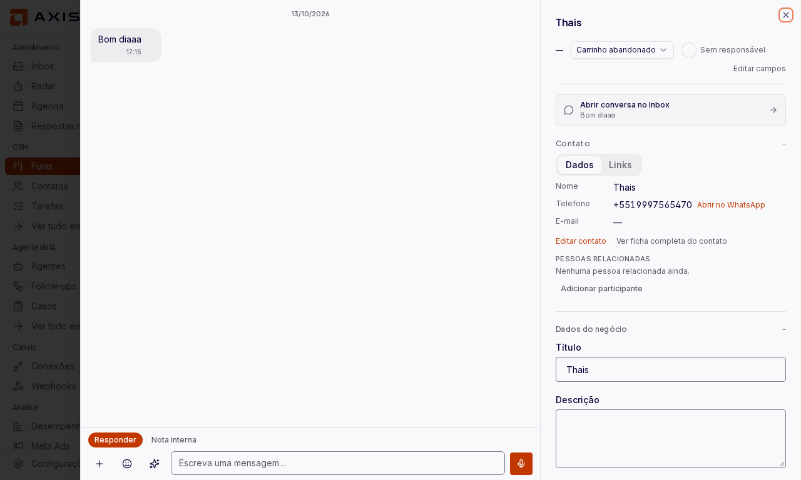
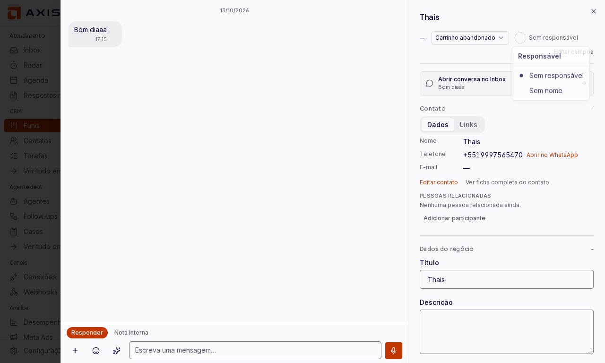
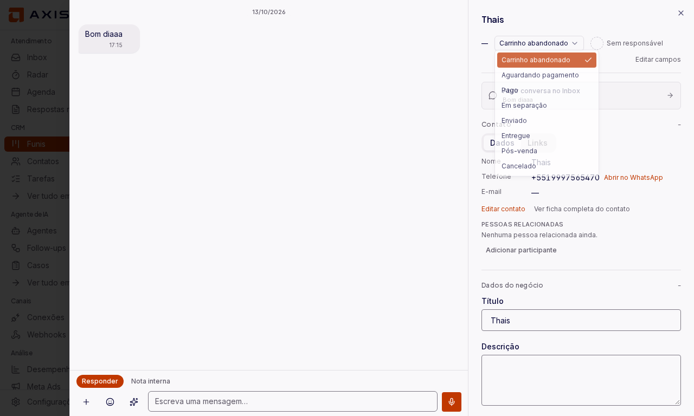
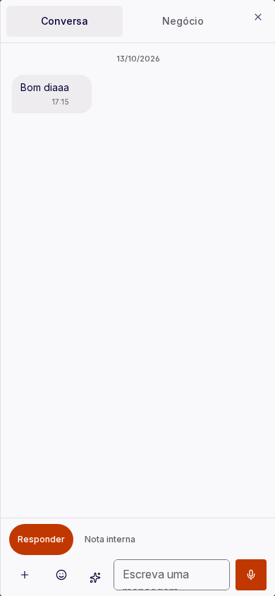
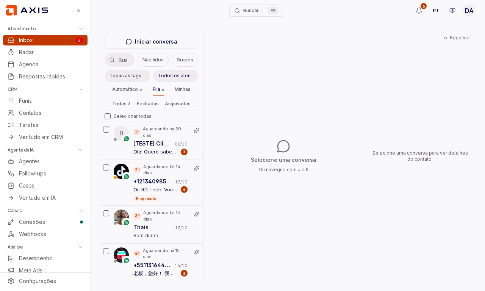

# Sync da upstream v1.89.0 — prova pela tela no staging

Prova do merge da v1.89.0 no fork (PR #36), feita pelo browser (Playwright) no staging, com banco do `baseline.sql` e conta real. Medidas com `getComputedStyle` / `getBoundingClientRect`, não a olho.

| Passo | O que prova | Imagem |
|---|---|---|
| 1 | Dossiê abre com a conversa ao lado; a seção Contato tem respiro de 20 px em cima e embaixo |  |
| 2 | Responsável editável: lista com "Sem responsável" e as pessoas da equipe |  |
| 3 | Seletor de etapa da upstream (`EtapaNoDossie`) convivendo com o cabeçalho do fork |  |
| 4 | Celular (390 px): abas Conversa e Negócio no dossiê |  |
| 5 | Inbox carrega depois do merge |  |

Não coberto aqui: `test:db`, a suíte e2e completa (ficam com o CI) e o envio real de anexo com legenda pela Inbox.
